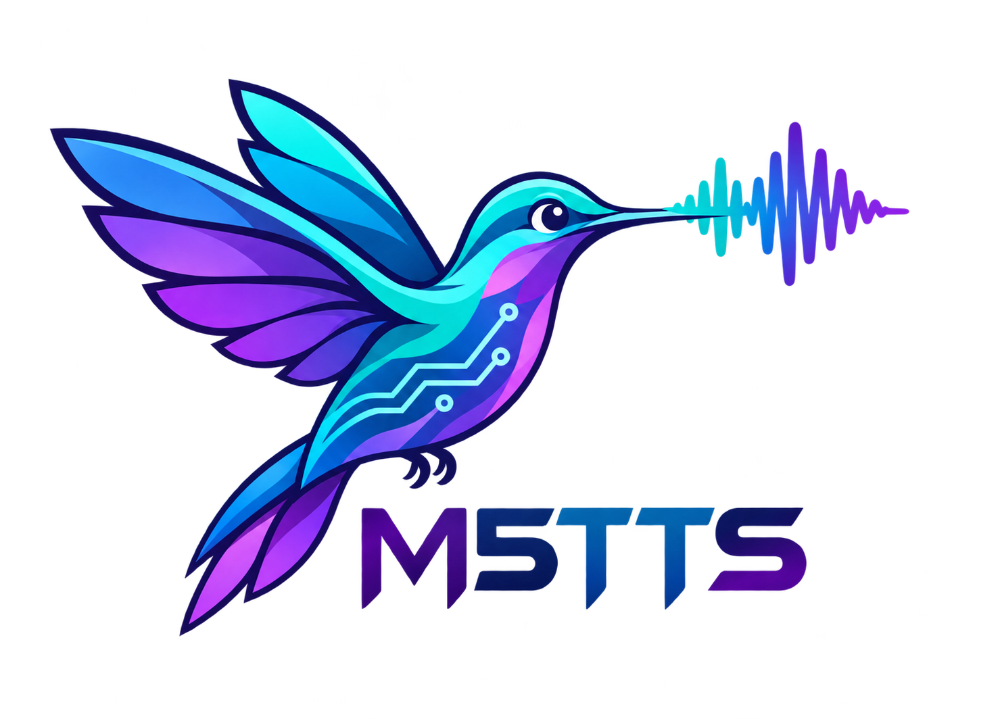

<p align="center">
  
</p>

<h1 align="center">M5-TTS</h1>

<p align="center">
  <b>A Mini-Scale Multilingual and Multi-Dialect Text-to-Speech Language Model with Multi-Token Prediction</b>
</p>

<p align="center">
  <b>50M LM · 6 Languages · Chinese Dialects · Zero-Shot Voice Cloning · CPU Streaming</b>
</p>

<p align="center">
  English | <a href="README_zh.md">简体中文</a><br>
  <a href="https://aslp-lab.github.io/M5-TTS-Demo-Page/m5-tts-v3.pdf">Technical Report</a> ·
  <a href="https://aslp-lab.github.io/M5-TTS-Demo-Page/">Audio Demos</a> ·
  <a href="https://huggingface.co/spaces/ASLP-lab/M5-TTS-Space">Try Online</a> ·
  <a href="https://huggingface.co/collections/ASLP-lab/m5-tts">Model Collection</a>
</p>

**M5-TTS** is a compact language-model-based speech generation system for multilingual and Chinese multidialect synthesis, zero-shot voice cloning, and dedicated multilingual voices. Its **50M-parameter LM excludes the speech codec** and combines a temporal backbone with a local multi-token prediction (MTP) module.

**Half the LM parameters of MOSS-TTS-Nano, with relative error reductions of 62.2% on Seed-ZH and 35.3% on Seed-EN.** M5-TTS (GRPO) achieves **1.37% CER / 2.91% WER**, compared with **3.62% / 4.50%** for Nano. Four-core CPU streaming achieves **RTF 0.653** and **225 ms warm first-chunk latency** in the reported Xeon configuration.

## ✨ Features

|  | Feature | What M5-TTS provides |
| :--- | :--- | :--- |
| **M₁** | **Mini** | 50M LM: a 30M temporal backbone and a 20M local decoder; codec parameters are separate. |
| **M₂** | **Multilingual** | Chinese, English, German, French, Japanese, and Korean. |
| **M₃** | **Multi-Dialect** | Cantonese (Yue) and Sichuanese (Chuan), with dialect-specific evaluations. |
| **M₄** | **Multi-Token Prediction** | 16 codebooks at 12.5 codec frames/s, with hierarchical temporal and within-frame generation. |
| **M₅** | **Language Modeling** | Reference-based zero-shot voice cloning, speaker-specific multilingual synthesis, and GRPO refinement. |

- **24 kHz speech output** with a causal speech-codec decoder.
- **CPU streaming** through inference graph optimization, reusable caches, stateful codec decoding, and adaptive chunk scheduling.
- **Global + local post-training feedback:** speaker similarity and pause rewards are combined with token-level CER process advantages.

## 🎧 Try M5-TTS

Open the [interactive Space](https://huggingface.co/spaces/ASLP-lab/M5-TTS-Space), upload reference speech and its accurate transcript, then enter the target text and select a language and optional accent (`yue` / `chuan`). The current demo accepts up to 250 characters of target text. Listen to multilingual and dialect comparisons on the [audio demo page](https://aslp-lab.github.io/M5-TTS-Demo-Page/).

The hosted Space runs on GPU and returns a completed audio clip. The CPU streaming measurements below describe the inference system evaluated in the report.

### Release status (2026-11-06)

| Resource | Status |
| :--- | :--- |
| [Technical report](https://aslp-lab.github.io/M5-TTS-Demo-Page/M5_TTS__A_Mini_Scale_Multilingual_and_Multi_Dialect_Text_to_Speech_Language_Model_with_Multi_Token_Prediction_v2.pdf) | Available. |
| [Audio demos](https://aslp-lab.github.io/M5-TTS-Demo-Page/) | Available. |
| [Online Space](https://huggingface.co/spaces/ASLP-lab/M5-TTS-Space) | Available, with [inference source and a checkpoint](https://huggingface.co/spaces/ASLP-lab/M5-TTS-Space/tree/main). |
| [Model collection](https://huggingface.co/collections/ASLP-lab/m5-tts) / [model repository](https://huggingface.co/ASLP-lab/M5-TTS) | Repository created; standalone model releases are planned. The model repository currently contains a model card, without weights. |
| Training, CPT, and GRPO code | Planned for release. |
| Packaged local / CPU streaming inference | Planned for release in this repository. |
| Standalone voice-cloning and speaker-specific checkpoints | Planned; the Space checkpoint is not labeled by training stage. |

## 📊 Evaluation

The following tables reproduce **all model configurations and measurements reported in Tables 2–5 of the technical report**, together with its CPU timing result. CER/WER are percentages (lower is better); SIM is speaker similarity (higher is better). **Bold metric values** mark the best reported score in each column, with dialects compared separately. `—` denotes an unreported measurement, not an unsupported capability.

**Voice Cloning** and **Custom Voice** use different speaker conditions and are reported separately; custom-voice scores are not matched zero-shot cloning comparisons. For systems with multiple preset voices, one voice is selected per language; unmarked Custom Voice configurations use a single fixed voice.

### Seed-TTS Eval

Benchmark: [Seed-TTS Eval](https://github.com/BytedanceSpeech/seed-tts-eval). All **12 reported model configurations** are included below.

| Model | Main model parameters (M) | Setting | Seed-ZH CER (%) ↓ | Seed-ZH SIM ↑ | Seed-EN WER (%) ↓ | Seed-EN SIM ↑ | Seed-Hard CER (%) ↓ | Seed-Hard SIM ↑ |
| :--- | :---: | :--- | ---: | ---: | ---: | ---: | ---: | ---: |
| **M5-TTS (CPT)** | 50 | Voice Cloning | 1.70 | 0.64 | 3.60 | 0.53 | 20.92 | 0.57 |
| **M5-TTS (GRPO)** | 50 | Voice Cloning | 1.37 | 0.65 | 2.91 | 0.53 | 17.48 | 0.59 |
| **M5-TTS** | 50 | Custom Voice | 1.26 | — | 1.88 | — | 18.19 | — |
| Audio8-TTS Preview | 170 | Voice Cloning | **1.21** | **0.68** | 1.96 | **0.57** | 19.63 | **0.63** |
| MOSS-TTS-Nano | 100 | Voice Cloning | 3.62 | 0.64 | 4.50 | 0.50 | 15.77 | **0.63** |
| Pocket TTS | 100 | Voice Cloning | — | — | **1.86** | 0.47 | — | — |
| Hojo-TTS-Light | 80 | Voice Cloning | 2.15 | 0.40 | 3.63 | 0.17 | 21.10 | 0.36 |
| Pocket TTS | 100 | Custom Voice<sup>a</sup> | — | — | 1.90 | — | — | — |
| Kokoro-TTS | 82 | Custom Voice<sup>b</sup> | 1.40 | — | 2.04 | — | **6.33** | — |
| Hojo-TTS-Light | 40 | Custom Voice<sup>c</sup> | 1.78 | — | 2.97 | — | 22.70 | — |
| Sano TTS | 2.27 | Custom Voice<sup>d</sup> | 2.42 | — | 2.40 | — | 7.08 | — |
| Tiny TTS | 1.6 | Custom Voice | — | — | 3.30 | — | — | — |

Parameter counts are in **millions**, excluding speech codecs. Audio8-TTS Preview uses the [Preview-0.1B checkpoint](https://huggingface.co/Edge0/Audio8-TTS-Preview-0.1b); its main-model parameter count is 170M in the report.

Selected preset voices:

- <sup>a</sup> Pocket TTS: EN `alba`.
- <sup>b</sup> Kokoro-TTS: ZH `zf_xiaobei`; EN `af_heart`.
- <sup>c</sup> Hojo-TTS-Light (40M): ZH `hojo_zh_f_01`; EN `hojo_en_m_02`.
- <sup>d</sup> Sano TTS: ZH `Xiaoya`; EN `Amy large`.

With half the LM parameters of MOSS-TTS-Nano, **M5-TTS (GRPO)** reduces Seed-ZH CER and Seed-EN WER by **62.2%** and **35.3%**, respectively. Nano remains stronger on **Seed-Hard** in both CER and SIM. Compared with Audio8-TTS Preview, M5-TTS (GRPO) has lower Seed-Hard CER, but higher Seed-ZH/EN error rates and lower SIM on all three subsets.

### MiniMax Multilingual

Benchmark: [MiniMax TTS-Multilingual-Test-Set](https://huggingface.co/datasets/MiniMaxAI/TTS-Multilingual-Test-Set). All **8 reported model configurations** are shown in both tables below. ZH / EN / DE / FR / JA / KO denote Chinese / English / German / French / Japanese / Korean. ZH, JA, and KO use CER; EN, DE, and FR use WER.

#### Content accuracy — CER/WER (%) ↓

| Model | Setting | ZH CER | EN WER | DE WER | FR WER | JA CER | KO CER |
| :--- | :--- | ---: | ---: | ---: | ---: | ---: | ---: |
| **M5-TTS (CPT)** | Voice Cloning | 2.54 | 3.67 | 4.60 | 8.15 | 12.71 | 3.10 |
| **M5-TTS (GRPO)** | Voice Cloning | 2.05 | 3.06 | 3.81 | 8.14 | 9.70 | 2.88 |
| **M5-TTS** | Custom Voice | 1.16 | 2.24 | **0.70** | 5.33 | 10.27 | **2.09** |
| MOSS-TTS-Nano | Voice Cloning | 1.80 | 5.34 | 11.18 | 18.64 | 40.22 | 8.21 |
| Pocket TTS | Voice Cloning | — | 2.41 | 3.50 | 6.71 | — | — |
| Pocket TTS | Custom Voice<sup>a</sup> | — | 1.99 | 4.14 | 7.88 | — | — |
| Sano TTS | Custom Voice<sup>b</sup> | 1.41 | **1.85** | 3.18 | 8.91 | — | — |
| Kokoro-TTS | Custom Voice<sup>c</sup> | **1.03** | 2.58 | — | **4.79** | **3.72** | — |

#### Speaker similarity — SIM ↑

| Model | Setting | ZH | EN | DE | FR | JA | KO |
| :--- | :--- | ---: | ---: | ---: | ---: | ---: | ---: |
| **M5-TTS (CPT)** | Voice Cloning | 0.70 | 0.62 | **0.63** | 0.51 | **0.72** | 0.66 |
| **M5-TTS (GRPO)** | Voice Cloning | 0.71 | 0.63 | **0.63** | **0.53** | **0.72** | 0.66 |
| **M5-TTS** | Custom Voice | — | — | — | — | — | — |
| MOSS-TTS-Nano | Voice Cloning | **0.73** | **0.65** | 0.54 | 0.51 | 0.70 | **0.67** |
| Pocket TTS | Voice Cloning | — | 0.61 | 0.54 | **0.53** | — | — |
| Pocket TTS | Custom Voice<sup>a</sup> | — | — | — | — | — | — |
| Sano TTS | Custom Voice<sup>b</sup> | — | — | — | — | — | — |
| Kokoro-TTS | Custom Voice<sup>c</sup> | — | — | — | — | — | — |

Selected preset voices:

- <sup>a</sup> Pocket TTS: EN `alba`; DE `juergen`; FR `estelle`.
- <sup>b</sup> Sano TTS: ZH `Xiaoya`; EN `Amy large`; DE `Thorsten`; FR `Siwis`.
- <sup>c</sup> Kokoro-TTS: ZH `zf_xiaobei`; EN `af_heart`; FR `ff_siwis`; JA `jf_alpha`.

**M5-TTS (GRPO)** has lower content error rates than Nano in **five of six languages**. Relative reductions for EN / DE / FR / JA / KO are **42.7% / 65.9% / 56.3% / 75.9% / 64.9%**. Nano retains lower Chinese CER; SIM is higher for M5-TTS in German, French, and Japanese. Pocket TTS has lower error rates in its reported EN/DE/FR voice-cloning results, while M5-TTS has higher SIM in EN/DE and the same displayed FR SIM.

Relative to CPT, GRPO lowers error rates on all three Seed subsets and all six MiniMax languages, with SIM maintained or improved at the displayed precision. These results evaluate the complete post-training recipe rather than isolating individual rewards.

### Chinese dialects

| Dialect | Model | ASR evaluator | Easy CER (%) ↓ | Easy SIM ↑ | Hard CER (%) ↓ | Hard SIM ↑ |
| :--- | :--- | :--- | ---: | ---: | ---: | ---: |
| Yue | **M5-TTS (GRPO)** | U2pp-Conformer-Yue | **8.55** | 0.47 | **8.70** | 0.51 |
| Yue | CosyVoice2-Yue | U2pp-Conformer-Yue | 10.33 | **0.62** | 9.49 | **0.67** |
| Yue | Llasa-1B-Yue | U2pp-Conformer-Yue | 10.89 | 0.51 | 12.78 | 0.55 |
| Chuan | **M5-TTS (GRPO)** | FireRedASR-AED | 5.08 | 0.58 | **7.78** | 0.59 |
| Chuan | CosyVoice2-WSC | FireRedASR-AED | **4.28** | **0.64** | 8.78 | **0.65** |

Yue is Cantonese and Chuan is Sichuanese. All systems within each dialect use the same ASR evaluator. M5-TTS has the lowest reported Cantonese CER on both subsets and lower Sichuanese Hard CER than CosyVoice2-WSC, while its Sichuanese Easy CER and dialectal SIM remain worse than the corresponding baselines.

### Subjective evaluation

**10 listeners**, scores from **1 to 5**. N-MOS: naturalness; S-MOS: speaker similarity; I-MOS: intelligibility; P-MOS: prosody and expressiveness.

| Model | N-MOS ↑ | S-MOS ↑ | I-MOS ↑ | P-MOS ↑ |
| :--- | ---: | ---: | ---: | ---: |
| Kokoro-TTS | 2.85 | — | **3.10** | 2.60 |
| MOSS-TTS-Nano | **3.00** | 2.85 | 2.65 | 2.80 |
| **M5-TTS** | 2.90 | **3.05** | 2.95 | **2.85** |

M5-TTS receives higher similarity, intelligibility, and prosody ratings than Nano, with a lower naturalness rating. Kokoro-TTS has the highest I-MOS. These are descriptive score differences; the report does not establish statistical significance.

### CPU streaming

| Model | Hardware | CPU cores | RTF ↓ | Warm first-chunk latency ↓ |
| :--- | :--- | :---: | ---: | ---: |
| **M5-TTS** | Intel Xeon Gold 6530 | 4 | 0.653 | 225 ms |

RTF is synthesis time divided by generated audio duration; **RTF < 1** indicates faster-than-real-time generation. Timing excludes model loading and warmup. The report provides this CPU result for M5-TTS only, without a baseline runtime comparison; it does not establish mobile or ARM performance.

## 🧩 How it works

### Hierarchical speech generation

<p align="center">
  
</p>

The temporal backbone predicts **codebook 0** at each frame. The local MTP Transformer then autoregressively generates **codebooks 1–15**. Historical frame embeddings are summed before temporal modeling, and completed frames are decoded incrementally by [Qwen3-TTS's speech tokenizer](https://github.com/QwenLM/Qwen3-TTS).

### Training and post-training

1. **Basic pre-training:** approximately **400,000 hours** of multilingual and regional speech, including Emilia, Emilia-YODAS, in-house recordings, and WenetSpeech datasets.
2. **Continued pre-training:** a curated **65,000-hour subset** of the pre-training corpus, emphasizing recording quality, expressiveness, and challenging pronunciation. This is a subset, not additional independent training data.
3. **GRPO:** utterance-level **SIM + pause** feedback provides a global advantage. ASR edit alignment produces per-character group-relative feedback; negative advantages propagate backward within a clause with exponential decay, then map to codec frames. The local CER process advantage is **added** to the global advantage, and all codebooks in a frame share the combined signal.
4. **Speaker-specific fine-tuning:** curated recordings of a designated speaker support a dedicated multilingual voice.

The global reward weights are SIM **1.0** and pause **0.5**; the local CER advantage weight is **0.5**, with KL coefficient **0.01**. Sentence-level CER broadcasting is disabled. Pre-training conditions on `accent → language → text`; speaker-specific fine-tuning adds the speaker field: `accent → speaker → language → text`.

### Efficient inference

The report describes a local-decoder frame graph, fused projections, KV and reference caches, stateful codec decoding, and adaptive **4 / 8 / 16-frame** CPU scheduling. GPU inference uses BF16 for the TTS LM, FP32 for the codec, and `torch.compile`; the quantitative runtime result above is the four-core CPU measurement.

## Limitations and roadmap

Current limitations include the bandwidth cost of 16-codebook local autoregressive decoding, 24 kHz output, artifacts in highly expressive speech, and weaker performance on difficult Chinese inputs and dialectal speaker preservation.

Planned directions include **8-codebook inference**, **48 kHz output**, better challenging-sample data selection and mixture ratios, and explicit control over **emotion, speaking style, and paralinguistic expressions** such as laughter and sighs.

## License

The [Hugging Face model card](https://huggingface.co/ASLP-lab/M5-TTS/blob/main/README.md) is tagged `Apache-2.0`. Separate licenses for the GitHub code and Space artifacts have not yet been published.

## Citation

If you use this work, please cite the technical report:

```bibtex
@misc{m5tts2026,
  title = {{M5-TTS: A Mini-Scale Multilingual and Multi-Dialect Text-to-Speech Language Model with Multi-Token Prediction}},
  author = {Wenhao Li and Jingbin Hu and Shengming Ling and Xiaming Ren and Haoyu Zhang and Jinrui Liang and Hanke Xie and Qirui Zhan and Guobin Ma and Huakang Chen and Chunbo Hao and Jianguo Zheng and Wenkang Hou and Dake Guo and Yuepeng Jiang and Linhan Ma and Yunxiang Chen and Houdun Liu and Su Feng and Chuang Ding and Pengcheng Zhu and Liumeng Xue and Lei Xie},
  year = {2026},
  howpublished = {Technical report},
  url = {https://github.com/ASLP-lab/M5-TTS}
}
```
