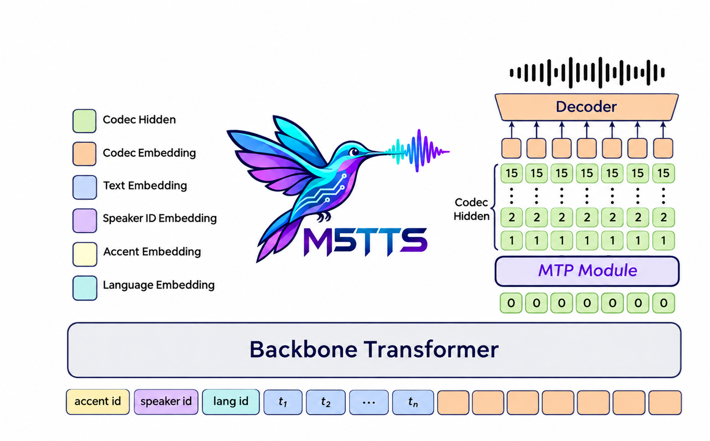
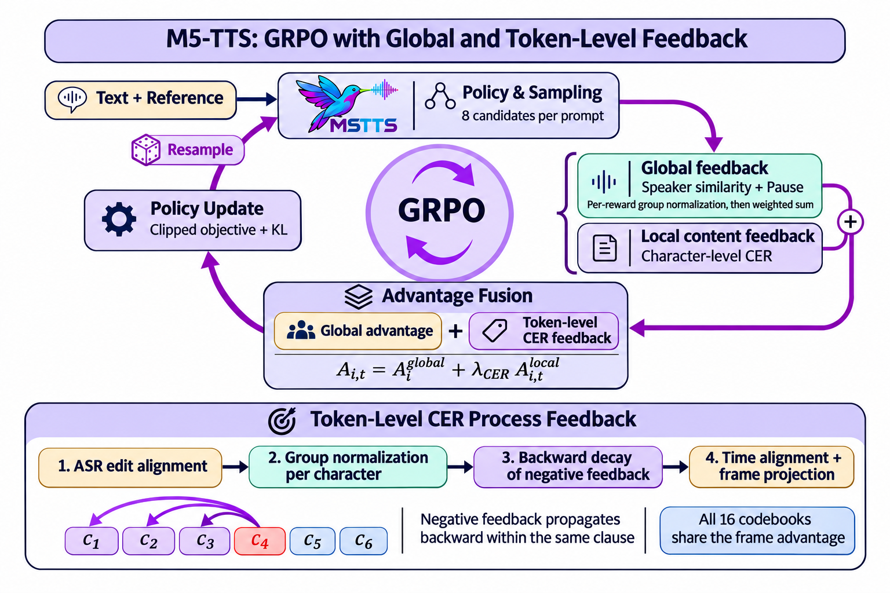
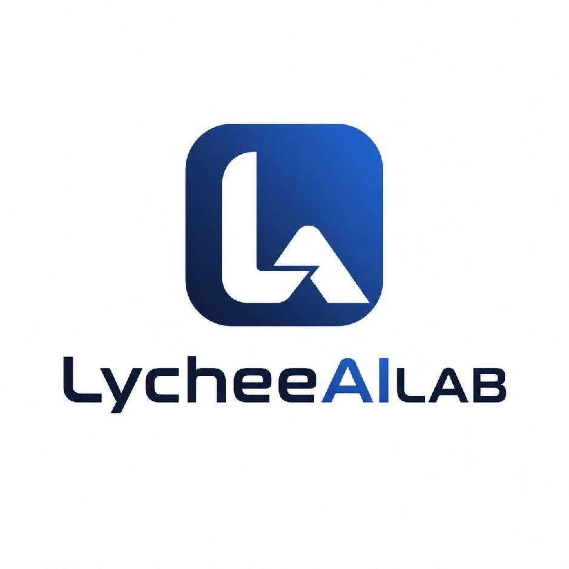
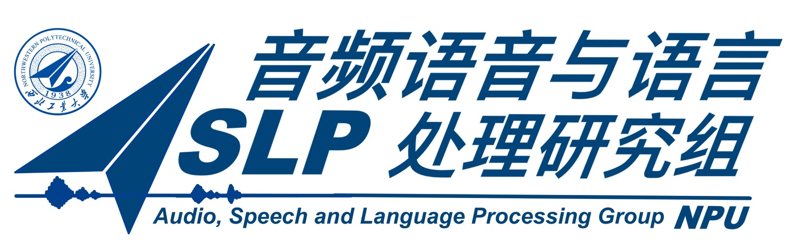

<p align="center">
  
</p>

<h1 align="center">M5-TTS</h1>

<p align="center">
  <b>A Mini-Scale Multilingual and Multi-Dialect Text-to-Speech Language Model with Multi-Token Prediction</b>
</p>

<p align="center">
  <b>50M LM · 6 Languages · Chinese Dialects · Zero-Shot Voice Cloning · CPU Streaming</b>
</p>

<p align="center">
  English | <a href="README_zh.md">简体中文</a><br>
  <a href="https://arxiv.org/abs/2611.10162">Technical Report</a> ·
  <a href="https://aslp-lab.github.io/M5-TTS-Demo-Page/">Audio Demos</a> ·
  <a href="https://huggingface.co/spaces/ASLP-lab/M5-TTS-Space">Try Online</a> ·
  <a href="https://huggingface.co/collections/ASLP-lab/m5-tts">Model Collection</a> ·
  <a href="https://huggingface.co/ASLP-lab/M5-TTS">Model Repository</a>
</p>

## Overview
https://github.com/user-attachments/assets/9fa7b835-a084-4cf6-9074-c45cb28f9b9e

**M5-TTS** is a compact language-model-based speech generation system for multilingual and Chinese multidialect synthesis, zero-shot voice cloning, and dedicated multilingual voices. Its **50M-parameter LM excludes the speech codec** and combines a temporal backbone with a local multi-token prediction (MTP) module.

**Half the LM parameters of MOSS-TTS-Nano, with relative error reductions of 62.2% on Seed-ZH and 35.3% on Seed-EN.** M5-TTS (GRPO) achieves **1.37% CER / 2.91% WER**, compared with **3.62% / 4.50%** for Nano. Four-core CPU streaming achieves **RTF 0.653** and **225 ms warm first-chunk latency** in the reported Xeon configuration.

**VoiceJudge naturalness evaluation:** our internal judge prefers M5-TTS over MOSS-TTS-Nano in **84.89% and 86.50%** of comparisons under the two A/B presentation orders.

### Features

|  | Feature | What M5-TTS provides |
| :--- | :--- | :--- |
| **M₁** | **Mini** | 50M LM: a 30M temporal backbone and a 20M local decoder; codec parameters are separate. |
| **M₂** | **Multilingual** | Chinese, English, German, French, Japanese, and Korean. |
| **M₃** | **Multi-Dialect** | Cantonese (Yue) and Sichuanese (Chuan), with dialect-specific evaluations. |
| **M₄** | **Multi-Token Prediction** | 16 codebooks at 12.5 codec frames/s, with hierarchical temporal and within-frame generation. |
| **M₅** | **Language Modeling** | Reference-based zero-shot voice cloning, speaker-specific multilingual synthesis, and GRPO refinement. |

- **24 kHz speech output** with a causal speech-codec decoder.
- **CPU streaming** through inference graph optimization, reusable caches, stateful codec decoding, and adaptive chunk scheduling.
- **Global + local post-training feedback:** speaker-similarity and pause rewards are normalized separately before weighted aggregation, then combined with CER-guided local process feedback derived from character edit errors.

### Try M5-TTS

Try reference-based voice cloning in the [interactive Space](https://huggingface.co/spaces/ASLP-lab/M5-TTS-Space), and explore multilingual and dialect comparisons on the [audio demo page](https://aslp-lab.github.io/M5-TTS-Demo-Page/).

| Resource | Link |
| :--- | :--- |
| Technical report | [M5-TTS report — v3](https://aslp-lab.github.io/M5-TTS-Demo-Page/m5-tts-v3.pdf) |
| Audio demos | [Multilingual and dialect samples](https://aslp-lab.github.io/M5-TTS-Demo-Page/) |
| Online demo | [Hugging Face Space](https://huggingface.co/spaces/ASLP-lab/M5-TTS-Space) |
| Model collection | [ASLP-lab / M5-TTS collection](https://huggingface.co/collections/ASLP-lab/m5-tts) |
| Model repository | [ASLP-lab / M5-TTS](https://huggingface.co/ASLP-lab/M5-TTS) |

**Release scope:** inference code, voice-cloning checkpoints, and speaker-specific checkpoints. Training, CPT, and GRPO training code are **not included** in the open-source release. VoiceJudge model weights and inference code are planned for release. Follow the model repositories and this repository for artifact availability.

## Contents

- [Overview](#overview)
  - [Features](#features)
  - [Try M5-TTS](#try-m5-tts)
- [Supported Languages](#supported-languages)
- [Quickstart](#quickstart)
  - [Installation](#installation)
  - [Voice Cloning](#voice-cloning)
  - [Preset Speaker](#preset-speaker)
  - [Python API](#python-api)
  - [Web Demo](#web-demo)
  - [ONNX Inference](#onnx-inference)
    - [CPU](#cpu)
    - [NVIDIA GPU](#nvidia-gpu)
  - [Export to ONNX](#export-to-onnx)
  - [Android ONNX Runtime Example](#android-onnx-runtime-example)
- [Evaluation](#evaluation)
- [How It Works](#how-it-works)
- [Limitations and Roadmap](#limitations-and-roadmap)
- [Contributors](#contributors)
  - [Data Acknowledgments](#data-acknowledgments)
- [License](#license)
- [Citation](#citation)
- [Contact](#contact)

## Supported Languages

| Language | `--lang` / Python `lang` |
| --- | --- |
| Chinese | `Chinese` |
| English | `English` |
| German | `German` |
| French | `French` |
| Japanese | `Japanese` |
| Korean | `Korean` |

For Cantonese, use `--lang Chinese --accent yue`; for Sichuan dialect, use `--lang Chinese --accent chuan`. Output audio is 24 kHz mono.

## Quickstart

Model weights are downloaded from Hugging Face automatically. Use `--model <repo_id_or_local_directory>` to select another model. PyTorch inference and ONNX export use [ASLP-lab/M5-TTS-Audio-Tokenizer](https://huggingface.co/ASLP-lab/M5-TTS-Audio-Tokenizer) as the default audio codec; use `--codec` to override it.

| Entry point | Default model |
| --- | --- |
| `infer_clone.py` / Web demo | `ASLP-lab/M5-TTS-50M-VoiceClone` |
| `infer_speaker.py` | `ASLP-lab/M5-TTS-50M-CustomVoice` |
| `infer_onnx.py` | `ASLP-lab/M5-TTS-50M-ONNX` |

Voice cloning and preset-speaker synthesis use different checkpoints. Selecting `speaker_id=1` on a loaded model does not switch its weights.

### Installation

Python 3.10 and Linux x86_64 are recommended. Run the following commands from the repository root:

```bash
conda create -n m5tts python=3.10 -y
conda activate m5tts
pip install -r requirements.txt
```

For PyTorch inference, install FlashAttention after PyTorch:

```bash
pip install --no-build-isolation flash-attn==2.7.3
```

PyTorch inference uses FlashAttention 2 and BF16 on NVIDIA GPUs. Building FlashAttention from source requires a compatible CUDA toolkit and C++ compiler. ONNX CPU inference does not require FlashAttention or a GPU.

### Voice Cloning

Provide the target text, reference audio, and its exact transcript:

```bash
python infer_clone.py \
  --text "你好，欢迎使用我们的语音合成模型。" \
  --prompt-wav assets/aslp_default_voice.wav \
  --prompt-text "猪携带该疾病，然后通过蚊子传染给人类。" \
  --output outputs/clone.wav
```

Replace both the reference recording and transcript to clone your own voice. Use only recordings you own or have permission to use.

### Preset Speaker

Generate speech without reference audio:

```bash
python infer_speaker.py \
  --text "你好，今天的天气很好，适合出去散散步。" \
  --speaker-id 1 \
  --output outputs/speaker.wav
```

Speaker IDs must be supported by the selected checkpoint.

### Python API

```python
from inference import M5TTS

model = M5TTS.from_pretrained(device="cuda")
audio = model.infer(
    "你好，欢迎使用我们的语音合成模型。",
    prompt_wav="assets/aslp_default_voice.wav",
    prompt_text="猪携带该疾病，然后通过蚊子传染给人类。",
    lang="Chinese",
)
model.save("outputs/clone_python.wav", audio)
```

For preset-speaker synthesis, load the dedicated CustomVoice checkpoint:

```python
from inference import M5TTS

model = M5TTS.from_pretrained("ASLP-lab/M5-TTS-50M-CustomVoice", device="cuda")
audio = model.infer("你好，今天的天气很好。", speaker_id=1)
model.save("outputs/speaker_python.wav", audio)
```

### Web Demo

Try [M5-TTS-Space](https://huggingface.co/spaces/ASLP-lab/M5-TTS-Space), or launch the local interface:

```bash
python app.py
```

Open **http://localhost:7860**, provide reference audio and its transcript, enter the target text, and click **Generate**. Use `python app.py --help` for server and model options.

### ONNX Inference

`infer_onnx.py` supports CPU and NVIDIA GPU inference using the same ONNX model. It downloads `ASLP-lab/M5-TTS-50M-ONNX` by default.

#### CPU

```bash
python infer_onnx.py \
  --device cpu --threads 4 \
  --text "你好，欢迎使用我们的语音合成模型。" \
  --prompt-wav assets/aslp_default_voice.wav \
  --prompt-text "猪携带该疾病，然后通过蚊子传染给人类。" \
  --output outputs/onnx_cpu.wav
```

#### NVIDIA GPU

```bash
python infer_onnx.py \
  --device cuda --device-id 0 \
  --text "你好，欢迎使用我们的语音合成模型。" \
  --prompt-wav assets/aslp_default_voice.wav \
  --prompt-text "猪携带该疾病，然后通过蚊子传染给人类。" \
  --output outputs/onnx_gpu.wav
```

The requirements install `onnxruntime-gpu`, which also supports CPU execution, and PyTorch's compatible CUDA 12/cuDNN 9 libraries. GPU execution still requires a compatible NVIDIA driver. Do not additionally install `onnxruntime` in the same environment.

Add `--stream` to write generated chunks incrementally. The script saves a WAV and a same-stem JSON statistics file. Existing output files are not overwritten. ONNX currently supports reference-based cloning; preset speaker IDs are available through the PyTorch API. CPU/GPU numerical results and performance may differ.

### Export to ONNX

Export an M5 checkpoint from Hugging Face:

```bash
python onnx/export.py \
  --model ASLP-lab/M5-TTS-50M-VoiceClone \
  --output outputs/onnx_export
```

The exporter downloads the matching codec and produces a complete FP32 ONNX bundle. `--model` also accepts a local checkpoint directory containing weights, configuration, conditioning metadata, and the matching text tokenizer. The output directory must not already exist.

To reuse an existing compatible codec when exporting another M5 checkpoint:

```bash
python onnx/export.py \
  --model ASLP-lab/M5-TTS-50M-VoiceClone \
  --reuse-codec ASLP-lab/M5-TTS-50M-ONNX \
  --output outputs/onnx_reexport
```

Use the exported directory as `--model` for `infer_onnx.py`. Run `python onnx/export.py --help` for cache, revision, and offline options.

### Android ONNX Runtime Example

The native Android example is in [`android/`](android/README.md). It runs offline ONNX inference on Android 9+ arm64 devices. Build the app, package a compatible ONNX model as `.m5model`, then import it into the app.

See the [Android guide](android/README.md) for JDK/Android SDK requirements, APK building, and model packaging.

## Evaluation

The tables below retain **all reported Seed, MiniMax, and dialect model configurations**, and include the latest VoiceJudge evaluation and CPU timing results. CER, WER, and MER are percentages (lower is better); SIM is speaker similarity (higher is better). **Bold metric values** mark the best reported score in each column, with dialects compared separately. In the Seed and MiniMax tables, <ins>underlined metric values</ins> mark the second-best score in each column; ties receive the same highlighting. `—` denotes an unreported measurement, not an unsupported capability.

**Voice Cloning** and **Custom Voice** use different speaker conditions and are reported separately; custom-voice scores are not matched zero-shot cloning comparisons. For systems with multiple preset voices, one voice is selected per language; unmarked Custom Voice configurations use a single fixed voice.

### Seed-TTS Eval

Benchmark: [Seed-TTS Eval](https://github.com/BytedanceSpeech/seed-tts-eval). All **12 reported model configurations** are included below.

We follow the official evaluation scripts: Mandarin transcription uses Paraformer-zh, English transcription uses OpenAI Whisper-large-v3, and SIM is the cosine similarity of embeddings from WavLM-large fine-tuned for speaker verification.

| Model | Main model parameters (M) | Setting | Seed-ZH CER (%) ↓ | Seed-ZH SIM ↑ | Seed-EN WER (%) ↓ | Seed-EN SIM ↑ | Seed-Hard CER (%) ↓ | Seed-Hard SIM ↑ |
| :--- | ---: | :--- | ---: | ---: | ---: | ---: | ---: | ---: |
| **M5-TTS (CPT)** | 50 | Voice Cloning | 1.70 | 0.64 | 3.60 | <ins>0.53</ins> | 20.92 | 0.57 |
| **M5-TTS (GRPO)** | 50 | Voice Cloning | 1.37 | <ins>0.65</ins> | 2.91 | <ins>0.53</ins> | 17.48 | <ins>0.59</ins> |
| **M5-TTS** | 50 | Custom Voice | <ins>1.26</ins> | — | <ins>1.88</ins> | — | 18.19 | — |
| Audio8-TTS Preview | 170 | Voice Cloning | **1.21** | **0.68** | 1.96 | **0.57** | 19.63 | **0.63** |
| MOSS-TTS-Nano | 100 | Voice Cloning | 3.62 | 0.64 | 4.50 | 0.50 | 15.77 | **0.63** |
| Pocket TTS | 100 | Voice Cloning | — | — | **1.86** | 0.47 | — | — |
| Hojo-TTS-Light | 80 | Voice Cloning | 2.15 | 0.40 | 3.63 | 0.17 | 21.10 | 0.36 |
| Pocket TTS | 100 | Custom Voice<sup>a</sup> | — | — | 1.90 | — | — | — |
| Kokoro-TTS | 82 | Custom Voice<sup>b</sup> | 1.40 | — | 2.04 | — | **6.33** | — |
| Hojo-TTS-Light | 40 | Custom Voice<sup>c</sup> | 1.78 | — | 2.97 | — | 22.70 | — |
| Sano TTS | 2.27 | Custom Voice<sup>d</sup> | 2.42 | — | 2.40 | — | <ins>7.08</ins> | — |
| Tiny TTS | 1.6 | Custom Voice | — | — | 3.30 | — | — | — |

Parameter counts are in **millions**, excluding speech codecs. Audio8-TTS Preview uses the [Preview-0.1B checkpoint](https://huggingface.co/Edge0/Audio8-TTS-Preview-0.1b); its main-model parameter count is 170M in the report.

Selected preset voices:

- <sup>a</sup> Pocket TTS: EN `alba`.
- <sup>b</sup> Kokoro-TTS: ZH `zf_xiaobei`; EN `af_heart`.
- <sup>c</sup> Hojo-TTS-Light (40M): ZH `hojo_zh_f_01`; EN `hojo_en_m_02`.
- <sup>d</sup> Sano TTS: ZH `Xiaoya`; EN `Amy large`.

With half the LM parameters of MOSS-TTS-Nano, **M5-TTS (GRPO)** reduces Seed-ZH CER and Seed-EN WER by **62.2%** and **35.3%**, respectively. Nano remains stronger on **Seed-Hard** in both CER and SIM. Compared with Audio8-TTS Preview, M5-TTS (GRPO) has lower Seed-Hard CER, but higher Seed-ZH/EN error rates and lower SIM on all three subsets.

### MiniMax Multilingual

Benchmark: [MiniMax TTS-Multilingual-Test-Set](https://huggingface.co/datasets/MiniMaxAI/TTS-Multilingual-Test-Set). All **8 reported model configurations** are shown in both tables below. ZH / EN / DE / FR / JA / KO denote Chinese / English / German / French / Japanese / Korean. ZH, JA, and KO use CER; EN, DE, and FR use WER.

For MiniMax, Mandarin transcription uses a locally loaded [SeACo-Paraformer](https://arxiv.org/abs/2308.03266), without auxiliary VAD or punctuation-restoration models. English, German, French, Japanese, and Korean use OpenAI Whisper-large-v3 with the target language explicitly specified. SIM uses the same WavLM-large model and cosine-similarity procedure as Seed-TTS Eval.

#### Content accuracy — CER/WER (%) ↓

| Model | Setting | ZH CER | EN WER | DE WER | FR WER | JA CER | KO CER |
| :--- | :--- | ---: | ---: | ---: | ---: | ---: | ---: |
| **M5-TTS (CPT)** | Voice Cloning | 2.54 | 3.67 | 4.60 | 8.15 | 12.71 | 3.10 |
| **M5-TTS (GRPO)** | Voice Cloning | 2.05 | 3.06 | 3.81 | 8.14 | <ins>9.70</ins> | <ins>2.88</ins> |
| **M5-TTS** | Custom Voice | <ins>1.16</ins> | 2.24 | **0.70** | <ins>5.33</ins> | 10.27 | **2.09** |
| MOSS-TTS-Nano | Voice Cloning | 1.80 | 5.34 | 11.18 | 18.64 | 40.22 | 8.21 |
| Pocket TTS | Voice Cloning | — | 2.41 | 3.50 | 6.71 | — | — |
| Pocket TTS | Custom Voice<sup>a</sup> | — | <ins>1.99</ins> | 4.14 | 7.88 | — | — |
| Sano TTS | Custom Voice<sup>b</sup> | 1.41 | **1.85** | <ins>3.18</ins> | 8.91 | — | — |
| Kokoro-TTS | Custom Voice<sup>c</sup> | **1.03** | 2.58 | — | **4.79** | **3.72** | — |

#### Speaker similarity — SIM ↑

| Model | Setting | ZH | EN | DE | FR | JA | KO |
| :--- | :--- | ---: | ---: | ---: | ---: | ---: | ---: |
| **M5-TTS (CPT)** | Voice Cloning | 0.70 | 0.62 | **0.63** | <ins>0.51</ins> | **0.72** | <ins>0.66</ins> |
| **M5-TTS (GRPO)** | Voice Cloning | <ins>0.71</ins> | <ins>0.63</ins> | **0.63** | **0.53** | **0.72** | <ins>0.66</ins> |
| **M5-TTS** | Custom Voice | — | — | — | — | — | — |
| MOSS-TTS-Nano | Voice Cloning | **0.73** | **0.65** | <ins>0.54</ins> | <ins>0.51</ins> | <ins>0.70</ins> | **0.67** |
| Pocket TTS | Voice Cloning | — | 0.61 | <ins>0.54</ins> | **0.53** | — | — |
| Pocket TTS | Custom Voice<sup>a</sup> | — | — | — | — | — | — |
| Sano TTS | Custom Voice<sup>b</sup> | — | — | — | — | — | — |
| Kokoro-TTS | Custom Voice<sup>c</sup> | — | — | — | — | — | — |

Selected preset voices:

- <sup>a</sup> Pocket TTS: EN `alba`; DE `juergen`; FR `estelle`.
- <sup>b</sup> Sano TTS: ZH `Xiaoya`; EN `Amy large`; DE `Thorsten`; FR `Siwis`.
- <sup>c</sup> Kokoro-TTS: ZH `zf_xiaobei`; EN `af_heart`; FR `ff_siwis`; JA `jf_alpha`.

**M5-TTS (GRPO)** has lower content error rates than Nano in **five of six languages**. Relative reductions for EN / DE / FR / JA / KO are **42.7% / 65.9% / 56.3% / 75.9% / 64.9%**. Nano retains lower Chinese CER; SIM is higher for M5-TTS in German, French, and Japanese. Pocket TTS has lower error rates in its reported EN/DE/FR voice-cloning results, while M5-TTS has higher SIM in EN/DE and the same displayed FR SIM.

Relative to CPT, GRPO lowers error rates on all three Seed subsets and all six MiniMax languages, with SIM maintained or improved at the displayed precision. These results evaluate the complete post-training recipe rather than isolating individual rewards.

### Chinese dialects

#### Cantonese (Yue) — MER (%) ↓ / SIM ↑

Benchmark: [WenetSpeech-Yue](https://aslp-lab.github.io/WenetSpeech-Yue/). **Mixed error rate (MER)** uses Chinese characters and English words as evaluation units. All three systems use U2pp-Conformer-Yue for ASR evaluation.

| Model | Easy MER (%) ↓ | Easy SIM ↑ | Hard MER (%) ↓ | Hard SIM ↑ |
| :--- | ---: | ---: | ---: | ---: |
| **M5-TTS (GRPO)** | **8.55** | 0.47 | **8.70** | 0.51 |
| CosyVoice2-Yue | 10.33 | **0.62** | 9.49 | **0.67** |
| Llasa-1B-Yue | 10.89 | 0.51 | 12.78 | 0.55 |

#### Sichuanese (Chuan) — CER (%) ↓ / SIM ↑

Benchmark: [WenetSpeech-Chuan](https://github.com/ASLP-lab/WenetSpeech-Chuan). Both systems use FireRedASR-AED for ASR evaluation.

| Model | Easy CER (%) ↓ | Easy SIM ↑ | Hard CER (%) ↓ | Hard SIM ↑ |
| :--- | ---: | ---: | ---: | ---: |
| **M5-TTS (GRPO)** | 5.08 | 0.58 | **7.78** | 0.59 |
| CosyVoice2-WSC | **4.28** | **0.64** | 8.78 | **0.65** |

M5-TTS has the lowest reported Cantonese MER on both subsets and lower Sichuanese Hard CER than CosyVoice2-WSC. Sichuanese Easy CER and dialectal speaker similarity remain areas for improvement.

### VoiceJudge-based naturalness evaluation

**VoiceJudge** is our internal A/B evaluator of speech naturalness and expressiveness, built from self-supervised speech representations and a Transformer scoring module, and trained on approximately **100,000 human-annotated preference pairs**. This experiment evaluates its **naturalness** dimension on **311 audio pairs**, strictly deduplicated against its preference-training data. Each pair contains M5-TTS and MOSS-TTS-Nano outputs for the same target text.

Each pair is assessed in both presentation orders, and A/B choices are mapped back to system identities before aggregation.

| Metric | Original: A=MOSS, B=M5 | Reversed: A=M5, B=MOSS |
| :--- | ---: | ---: |
| Evaluated pairs | 311 | 311 |
| **M5-TTS wins** | **264 (84.89%)** | **269 (86.50%)** |
| MOSS-TTS-Nano wins | 47 (15.11%) | 42 (13.50%) |
| Ties | 0 | 0 |
| Mean reward: M5-TTS | 0.2586 | 0.3231 |
| Mean reward: MOSS-TTS-Nano | -0.6542 | -0.6234 |

| Preferred system: original → reversed | Pairs | Percentage |
| :--- | ---: | ---: |
| M5-TTS → M5-TTS | 255 | 81.99% |
| MOSS-TTS-Nano → MOSS-TTS-Nano | 33 | 10.61% |
| MOSS-TTS-Nano → M5-TTS | 14 | 4.50% |
| M5-TTS → MOSS-TTS-Nano | 9 | 2.89% |
| **Same preferred system (subtotal)** | **288** | **92.60%** |

VoiceJudge favors M5-TTS under both orders, with a **1.61 percentage-point** change in win rate after reversal. The same **311 pairs** are scored twice; the preferred system is unchanged on **92.60%** of them. Reward values are VoiceJudge scores. VoiceJudge is used for evaluation in this experiment.

### CPU streaming

| Model | Hardware | CPU cores | RTF ↓ | Warm first-chunk latency ↓ |
| :--- | :--- | ---: | ---: | ---: |
| **M5-TTS** | Intel Xeon Gold 6530 | 4 | 0.653 | 225 ms |

RTF is synthesis time divided by generated audio duration; **RTF < 1** indicates faster-than-real-time generation. Timing excludes model loading and warmup. The report provides this CPU result for M5-TTS only, without a baseline runtime comparison; it does not establish mobile or ARM performance.

## How It Works

### Hierarchical speech generation

<p align="left">
  
</p>

The temporal backbone predicts **codebook 0** at each frame. The local MTP Transformer then autoregressively generates **codebooks 1–15**. Historical frame embeddings are summed before temporal modeling, and completed frames are decoded incrementally by [Qwen3-TTS's speech tokenizer](https://github.com/QwenLM/Qwen3-TTS).

### Training and post-training

1. **Basic pre-training:** approximately **400,000 hours** of multilingual and regional speech, including Emilia, Emilia-YODAS, in-house recordings, and WenetSpeech datasets.
2. **Continued pre-training:** a curated **65,000-hour subset** of the pre-training corpus, emphasizing recording quality, expressiveness, and challenging pronunciation. This is a subset, not additional independent training data.
3. **GRPO:** normalize utterance-level **SIM** and **pause** rewards separately within the candidate group for the same prompt, then weight and sum them to obtain the global advantage. ASR edit alignment assigns character-level edit counts to the target text. Group normalization converts these counts into relative advantages at each character position; negative feedback propagates backward within each clause with exponential decay and is projected onto codec frames through time alignment. This **CER-guided local process feedback** is added to the global advantage for policy updates. All 16 codec tokens within a frame share the resulting frame-level advantage.
4. **Speaker-specific fine-tuning:** curated recordings of a designated speaker support a dedicated multilingual voice.

Global advantage: `1.0 × norm(SIM) + 0.5 × norm(Pause)`. Each `norm` is computed separately over candidates for the same prompt; the weighted sum is used directly, with no further normalization. The CER-guided local process advantage weight is **0.5**, and the KL coefficient is **0.01**. Sentence-level CER broadcasting is disabled.

Pre-training conditions on `accent → language → text`; speaker-specific fine-tuning adds the speaker field: `accent → speaker → language → text`.

<p align="left">
  
</p>

### Efficient inference

The report describes a local-decoder frame graph, fused projections, KV and reference caches, stateful codec decoding, and adaptive **4 / 8 / 16-frame** CPU scheduling. GPU inference uses BF16 for the TTS LM, FP32 for the codec, and `torch.compile`; the quantitative runtime result above is the four-core CPU measurement.

## Limitations and Roadmap

Current limitations include the bandwidth cost of 16-codebook local autoregressive decoding, 24 kHz output, artifacts in highly expressive speech, and weaker performance on difficult Chinese inputs and dialectal speaker preservation.

Planned directions include **8-codebook inference**, **48 kHz output**, better challenging-sample data selection and mixture ratios, and explicit control over **emotion, speaking style, and paralinguistic expressions** such as laughter and sighs.

## Contributors

<table>
  <tr>
    <td align="left" valign="middle" width="240" height="140">
      <a href="https://www.nwpu.edu.cn/"></a>
    </td>
    <td align="left" valign="middle" width="240" height="140">
      
    </td>
    <td align="left" valign="middle" width="240" height="140">
      
    </td>
  </tr>
  <tr>
    <td align="left" valign="middle" width="240" height="140">
      
    </td>
    <td align="left" valign="middle" width="240" height="140">
      
    </td>
    <td align="left" valign="middle" width="240" height="140">
      
    </td>
  </tr>
</table>

### Data Acknowledgments

Our preset-speaker models use data from the [Multi-Speaker Multi-Style Voice Cloning Challenge 2021 (M2VoC)](https://arxiv.org/abs/2104.01818). We thank **Fen Hong (Originbeat Inc.)** for support related to these data.

## License

Please refer to the license terms accompanying each code and checkpoint release, including the linked model repositories and Space.

The included Qwen 12Hz codec implementation is licensed under Apache-2.0; see its [third-party attribution](m5/codec_qwen12hz/NOTICE).

## Citation

If you use this work, please cite the technical report:

```bibtex
@misc{m5tts2026,
  title = {{M5-TTS: A Mini-Scale Multilingual and Multi-Dialect Text-to-Speech Language Model with Multi-Token Prediction}},
  author = {Wenhao Li and Jingbin Hu and Shengming Ling and Xiaming Ren and Haoyu Zhang and Jinrui Liang and Hanke Xie and Qirui Zhan and Guobin Ma and Huakang Chen and Chunbo Hao and Jianguo Zheng and Wenkang Hou and Dake Guo and Yuepeng Jiang and Linhan Ma and Yunxiang Chen and Houdun Liu and Su Feng and Chuang Ding and Pengcheng Zhu and Liumeng Xue and Lei Xie},
  year = {2026},
  howpublished = {Technical report},
  url = {https://aslp-lab.github.io/M5-TTS-Demo-Page/m5-tts-v3.pdf}
}
```

## Contact

For questions and feedback, please contact **Wenhao Li** at [wenhao.li@mail.nwpu.edu.cn](mailto:wenhao.li@mail.nwpu.edu.cn). You can also open an [issue](https://github.com/ASLP-lab/M5-TTS/issues) or visit the [ASLP@NPU website](http://www.npu-aslp.org/english).

<p align="left">
  <a href="http://www.npu-aslp.org/english"></a>
</p>

Join the M5-TTS WeChat group for discussion and updates. Scan the QR code below, or click it to open the full-size image. If the code has expired, contact us by email for a new invitation.

<p align="left">
  <a href="assets/wechat-group.jpg"></a>
</p>
