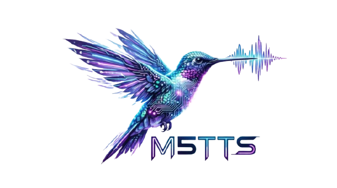

  

<h1 align="center">M5-TTS</h1>

  <b>Mini, Multilingual, Multi-Accent, Multi-Token Prediction, and LLM-based Modeling</b>

  小模型 · 多语种与多口音 · CPU 流式语音合成

  <a href="README.md">English</a> | 简体中文 
  <a href="https://huggingface.co/collections/ASLP-lab/m5-tts">🤗 模型合集</a> ·
  <a href="https://huggingface.co/ASLP-lab/M5-TTS">🤗 模型仓库</a>

**M5-TTS** 探索基于语言模型的语音合成系统能做到多小，同时保留清晰的发音、音色克隆和多语种生成能力。项目围绕小型化、CPU 部署与流式合成展开，并通过 SFT 和 GRPO 实验提升生成质量。

## ✨ 核心特性

| | 特性 | M5-TTS 的探索方向 |
| :--- | :--- | :--- |
| **M₁** | **Mini：小型化** | 开展包含 **50M 级配置（30M + 20M）** 在内的模型规模实验，面向高效部署与稳定的日常播报。 |
| **M₂** | **Multilingual：多语种** | 已开展**中文、英语、德语、法语、日语、韩语**六种语言的评测。 |
| **M₃** | **Multi-Accent：多口音 / 多方言** | 覆盖**川渝方言、吴语、粤语**的实验，探索方言微调与 GRPO 后训练。 |
| **M₄** | **Multi-Token Prediction：多 Token 预测** | 采用 MTP 进行语音 Token 建模，探索小模型下的高效生成。 |
| **M₅** | **LLM-based Modeling：语言模型驱动** | 基于语言模型生成语音，开展**音色克隆、精品发言人微调与 GRPO 后训练**实验。 |

- **CPU / GPU 流式合成。** 下方记录中，四核 CPU 流式推理达到 **RTF 0.653、预热后首包 225 ms**。
- **24 kHz 语音输出。** 更高采样率与更丰富的指令控制列入后续规划。

上述参数规模来自实验配置。各下载版本的准确参数量及其包含的模块，将随具体 checkpoint 补充。MTP 的独立提速幅度与消融结果尚待补充。

## 📊 当前结果

以下为开发阶段的实验记录。不同表格使用各自的实验配置，不代表同一个发布 checkpoint；缺失数据及发布版本对应关系保留空白。

### 流式合成与 CPU 推理

<!-- 来源：提供的开发记录第 24 页，嵌入的性能表。 -->

| 硬件 | 模式 | RTF ↓ | 预热后首包 ↓ |
| :--- | :--- | ---: | ---: |
| Intel Xeon Gold 6530，单核 CPU | 流式 | 1.587 | 541 ms |
| Intel Xeon Gold 6530，四核 CPU | 流式 | **0.653** | **225 ms** |
| Intel Xeon Gold 6530，四核 CPU | 非流式 | 0.627 | |
| NVIDIA RTX 4090 | 流式 | **0.098** | **20.1 ms** |

**测试条件：** 每组使用相同的 10 句文本，不计 warmup。CPU 使用 FP32 TTS 与 FP32 codec；GPU 使用 PyTorch BF16 与编译优化。CPU 测试中五个音色约 6.2 秒的额外准备时间未计入。CPU / GPU 的首包音频长度分别为 220 / 60 ms。以上引用已有记录，未重新测试。RTF 为推理耗时与生成音频时长之比，小于 1 表示生成速度快于实时播放。

| Checkpoint | Batch size | 操作系统 / 运行时版本 |
| :--- | :--- | :--- |
| | | |

### 发音准确度与音色相似度

<!-- 来源：提供的开发记录第 6 页，标记为 2.0-100step 的独立表格。 -->

实验标识：**`2.0-100step`**。

| 测试集 | 指标 ↓ | 错误率 | 音色相似度 ↑ |
| :--- | :--- | ---: | ---: |
| Seed-ZH | CER | **1.46%** | 0.6453 |
| Seed-EN | WER | **3.13%** | 0.5272 |
| Seed-Hard | CER | 18.41% | 0.5854 |

CER 为字错误率，WER 为词错误率；音色相似度保留原记录的 0–1 数值。

| 完整 checkpoint | ASR 评测器 | 音色编码器 | 样本量 |
| :--- | :--- | :--- | :--- |
| | | | |

前期 CPT → GRPO 实验

<!-- 来源：提供的开发记录第 6 页，白色 Seed 表。 -->

| 实验 | Seed-ZH CER ↓ | ZH SIM ↑ | Seed-EN WER ↓ | EN SIM ↑ |
| :--- | ---: | ---: | ---: | ---: |
| `cpt_model_4_109620` | 3.81% | 0.6548 | 4.72% | 0.5572 |
| `grpo_cn_50step` | 3.55% | 0.6576 | 4.00% | 0.5584 |
| `grpo_cn_100step` | 2.74% | 0.6641 | 4.86% | 0.5611 |

这组实验体现了中文发音准确度的改善，英文 WER 未呈现一致提升。`grpo_cn_100step` 与 `2.0-100step` 是不同的实验标识。

### 多语种合成

<!-- 来源：提供的开发记录第 10 页，Minimax multilingual 中标记为 M5 的表格。 -->

测试集：**Minimax multilingual**；实验记录中的模型标识：**M5**。

| 语言 / 变体 | 指标 ↓ | 错误率 |
| :--- | :--- | ---: |
| 中文 | CER | 2.3983% |
| 英语 | WER | 3.7817% |
| 德语 | WER | 3.5912% |
| 法语 | WER | 16.7612% |
| 日语 | CER | 11.1923% |
| 韩语 | CER | 4.6992% |
| 粤语 | CER | 17.9779% |

| Checkpoint | ASR 评测器 | 样本量 |
| :--- | :--- | :--- |
| | | |

方言实验记录

<!-- 来源：提供的开发记录第 12–13 页，标记为 grpo 的一行。 -->

| 测试集 | 子集 | 指标 | 记录值 |
| :--- | :--- | :--- | ---: |
| WSC-Eval-TTS | Easy | | 4.44 |
| WSC-Eval-TTS | Hard | | 6.63 |
| WSW | Easy | | 17.15 |
| WSW | Hard | | 67.00 |
| WSYue-TTS-eval | Base | | 7.06 |
| WSYue-TTS-eval | Coverage | | 8.18 |

原记录行标识为 `grpo`，未填写指标名称及 checkpoint。此处保留原始数值，不补写指标名称或百分比单位。吴语合成，尤其是 Hard 子集，仍需继续改善。

## 🤗 模型与资源

| 资源 | 链接 |
| :--- | :--- |
| Hugging Face 合集 | [ASLP-lab / M5-TTS](https://huggingface.co/collections/ASLP-lab/m5-tts) |
| 模型仓库 | [ASLP-lab/M5-TTS](https://huggingface.co/ASLP-lab/M5-TTS) |
| 技术报告 | |
| 音频 Demo | |
| 推理代码 | |

Hugging Face 仓库当前包含模型卡。权重文件、配置与经过验证的使用说明将在就绪后补充。

| Checkpoint 文件 | 参数量 | 支持语言 / 方言 | 下载 |
| :--- | :--- | :--- | :--- |
| | | | |

### 安装

<!-- 在此补充已验证的环境要求与安装命令。 -->

### 推理

<!-- 在此补充基于实际发布 checkpoint 与推理接口的可运行示例。 -->

## 🎧 音频示例

| 能力 | 参考音频 | 合成音频 |
| :--- | :--- | :--- |
| 音色克隆 | | |
| 多语种合成 | | |
| 方言合成 | | |
| 精品发言人 | | |

## 🎯 目标与路线图

第一阶段聚焦：**小模型、清晰发音、实用的音色克隆、多语种覆盖，以及可在 CPU 上运行的流式合成。**

- [x] 包含 50M 级配置在内的模型规模探索
- [x] 多语种与中文方言实验
- [x] 音色克隆与精品发言人训练实验
- [x] GRPO 实验与初步流式 / CPU 性能测试
- [x] Hugging Face 模型入口
- [ ] 上传模型权重与配置，补齐 checkpoint 与评测结果的对应关系
- [ ] 发布推理代码、可复现评测与音频 Demo
- [ ] 改善中文困难文本、吴语合成与韵律停顿
- [ ] 评估同一发言人的多方言合成能力
- [ ] 增加情感 / 风格标签、指令控制与发音 / 拼音修复
- [ ] 评估非言语发声控制
- [ ] 优化 ONNX、Transformers、vLLM / SGLang 适配与整数量化
- [ ] 验证手机与其他端侧设备部署
- [ ] 探索知识蒸馏与 on-policy distillation
- [ ] 探索基于高采样率 vocoder 的 48 kHz 双声道输出

## 许可证

[Hugging Face 模型卡](https://huggingface.co/ASLP-lab/M5-TTS/blob/main/README.md) 标记为 `Apache-2.0`。

| 组件 | 许可证 |
| :--- | :--- |
| 仓库代码 | |

## 引用

<!-- 在此补充公开技术报告与核实后的 BibTeX。 -->
